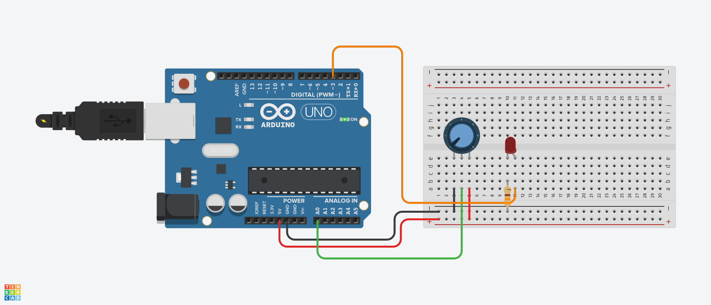
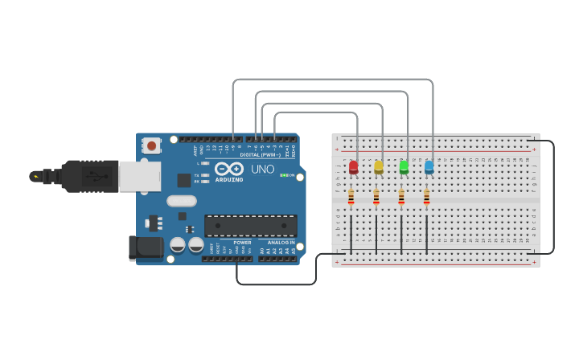

# Lab 13 - Digital Read and Analog Signal

## Today Exercises

**เข็คส่งงาน:** https://docs.google.com/spreadsheets/d/1xQlxN1a3C70LCMTHaKBb0TtkZ5BFR1AWwqTLaZSSvcM/edit?usp=sharing

| ข้อ                              | รายละเอียด                                                                                                                                                                                                                                                                                 | ตัวอย่าง                              |
|---------------------------------|-------------------------------------------------------------------------------------------------------------------------------------------------------------------------------------------------------------------------------------------------------------------------------------------|-------------------------------------|
| 1. Potentiometer Analog Reading | ให้เขียนโปรแกรม Arduino เพื่อควบคุมความสว่างของ LED โดยใช้ Potentiometer เพื่อปรับค่าความสว่าง LED ให้มีการเปลี่ยนแปลงตามค่าที่ Potentiometer ปรับ     - **Hint:** [Tinkercad](https://www.tinkercad.com/things/ga6pNRFHVXI-l25-analog-reading?sharecode=kZHN-vveGuvqCZl4ss-zFi1ZmuD0M5KhiZzZYMhNxIc) |          |        |
| 2. Analog LED Fading            | เลือกใช้ PWM Pin อื่นๆ เป็นจำนวน 4 Pin โดยแต่ละ Pin มีการ Fading ดังนี้   - LED1 Fading จาก Off ไปยัง Full-Bright   - LED2 Fading จาก Off ไปยัง Full-Bright เร็วเป็นสองเท่าของ LED1    - LED3 Fading จาก Full-Bright ไปยัง Off   - LED4 Fading จาก Half-Bright ไปยัง Full-Bright                |  |

** ถ้าส่ง Online แล้ว ให้เลือกทำ 1 ข้อ จากทั้งหมด 2 ข้อ