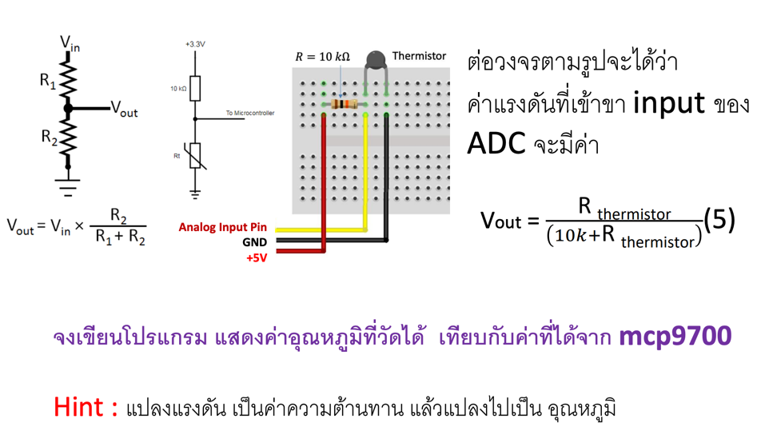

# Lab 14 - Sensor and LCD

## Today Exercises

**เข็คส่งงาน:** https://docs.google.com/spreadsheets/d/1xQlxN1a3C70LCMTHaKBb0TtkZ5BFR1AWwqTLaZSSvcM/edit?usp=sharing

| ข้อ                         | รายละเอียด                                                                           | ตัวอย่าง                      |
|----------------------------|-------------------------------------------------------------------------------------|-----------------------------|
| **1. Ultrasonic Sensor:**  | โปรแกรมวัดระยะทาง แสดงผลออก Serial monitor                                           |   | 
| **2. Temperature Sensor:** | ต่อวงจร Sensor อุณหภูมิโดยใช้ MCP9700 และเขียนโปรแกรมแสดงค่าอุณหภูมิที่วัดได้บน Serial Monitor    |  | 
| **3. Thermistor Sensor:**  | ต่อวงจร Sensor อุณหภูมิโดยใช้ Thermistor และเขียนโปรแกรมแสดงค่าอุณหภูมิที่วัดได้บน Serial Monitor |   | 

