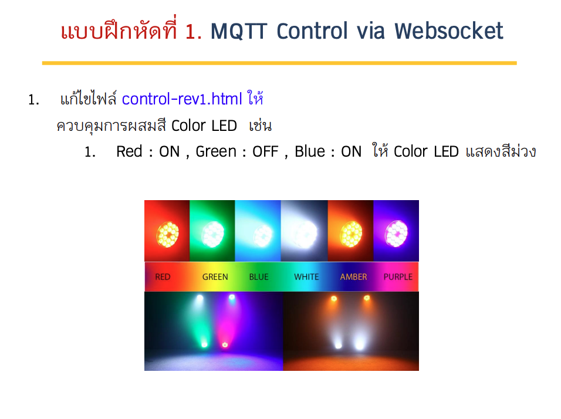
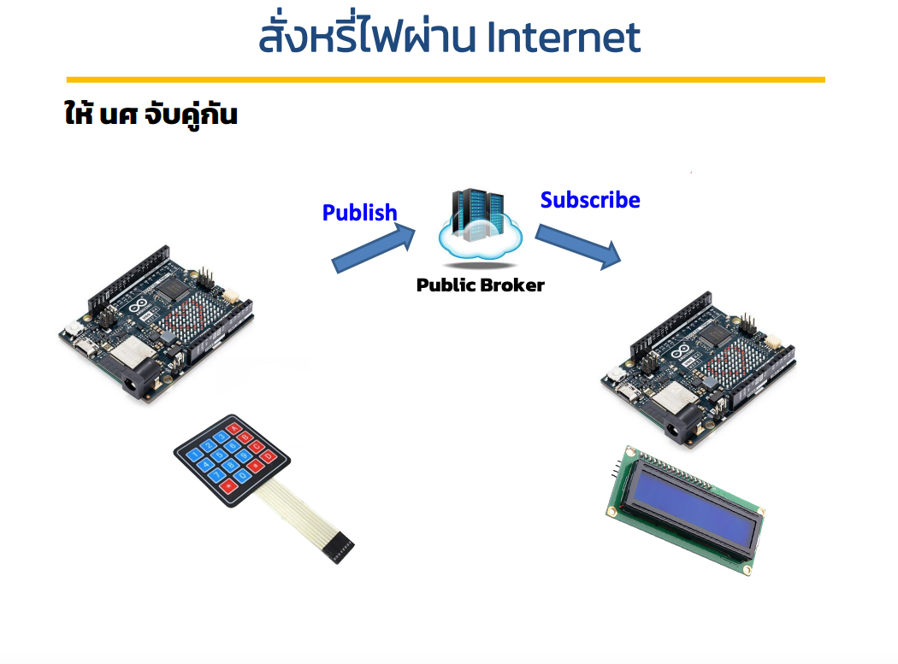
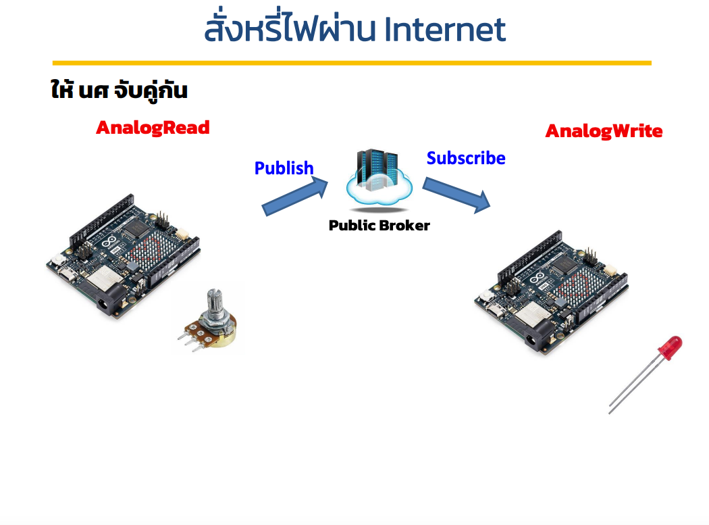

# Lab 15 - Internet of Things

## Today Exercises

**เข็คส่งงาน:** https://docs.google.com/spreadsheets/d/1xQlxN1a3C70LCMTHaKBb0TtkZ5BFR1AWwqTLaZSSvcM/edit?usp=sharing

| ข้อ                  | รายละเอียด                                                                                                              | ตัวอย่าง                    |
|---------------------|------------------------------------------------------------------------------------------------------------------------|---------------------------|
| **1. MQTT Website** | แก้ไขไฟล์ control-rev1.html ให้ควบคุมการผสมสี Color LED เช่น   - Red : ON , Green : OFF , Blue : ON ให้ Color LED แสดงสีม่วง |    | 
| **2. MQTT Keypad**  | ให้นศ จับคู่กัน - คนส่งส่งค่าจาก Keypad   - คนรับนำค่าไปสั่งในจอ LCD                                                        |   | 
| **3. MQTT Analog**  | ให้นศ จับคู่กัน - คนส่งส่งค่าจาก Potentiometer   - คนรับนำค่าไปสั่งให้หลอด LED หรี่                                            |  | 

